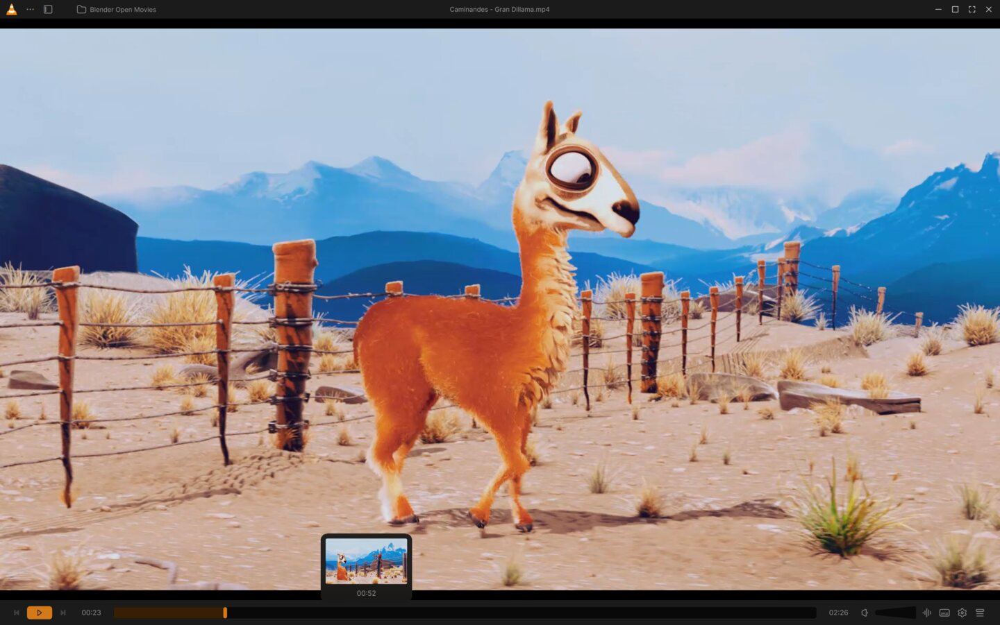
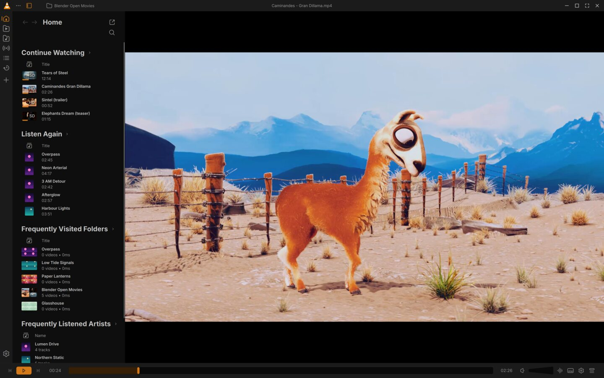
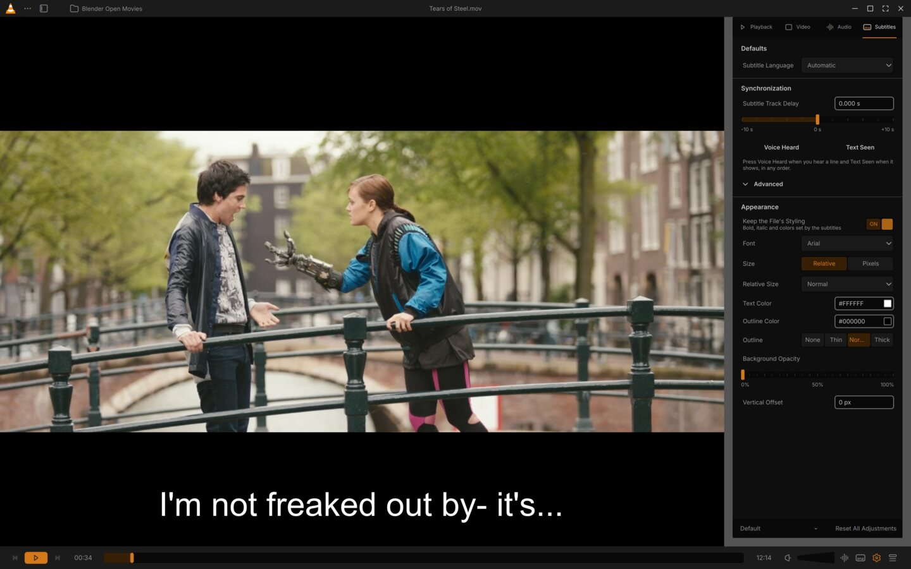
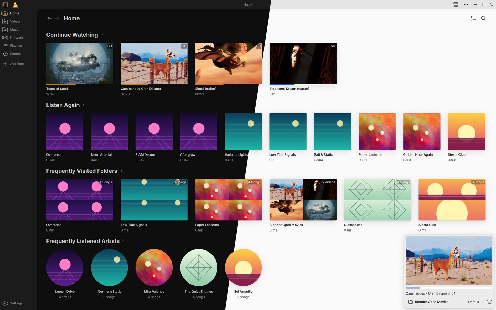
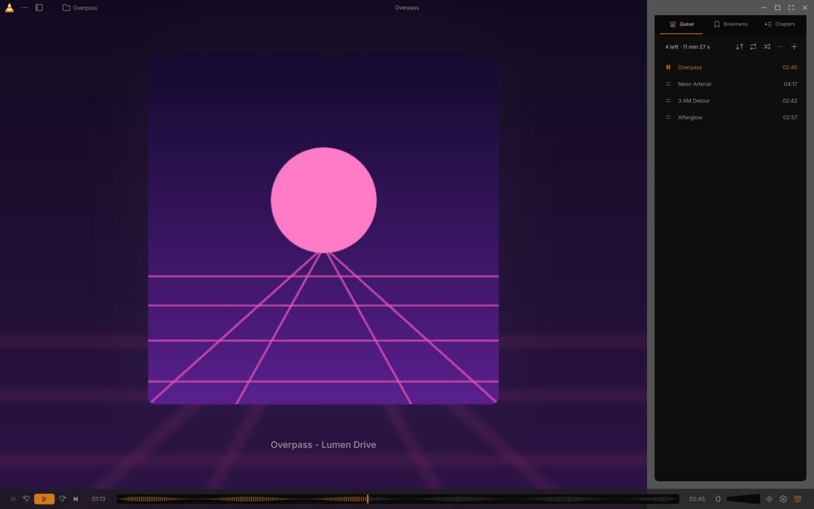
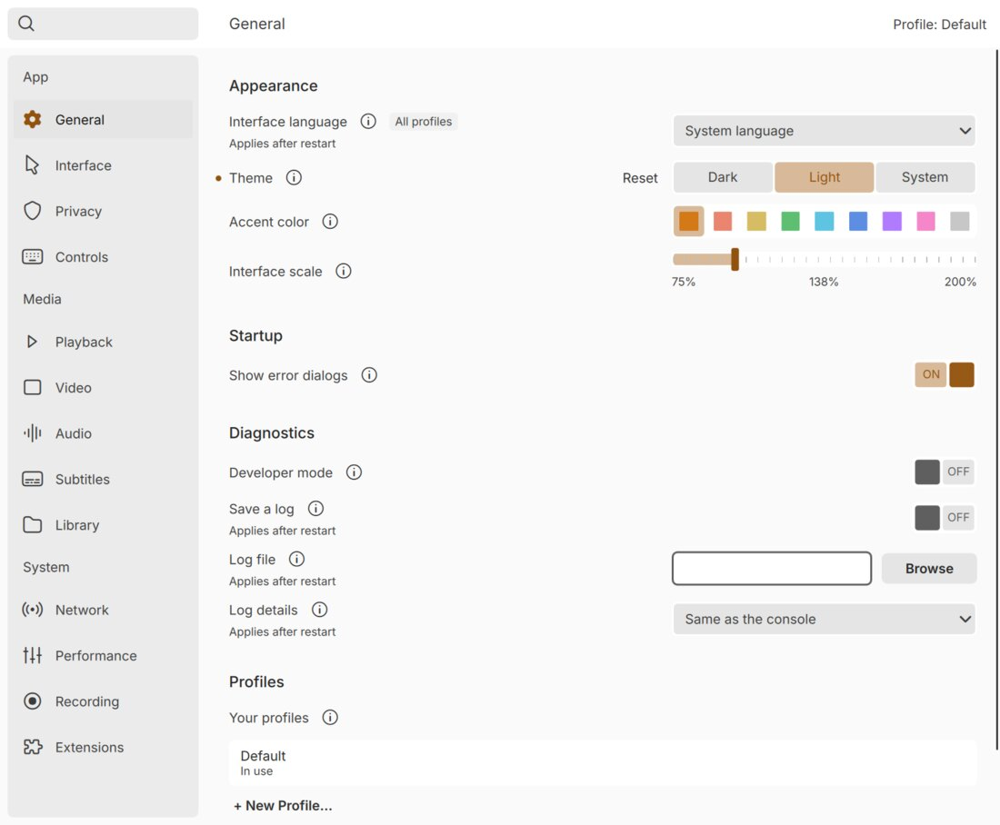

# jVLC

**The player that plays everything, with an interface that finally gets out of the way.**

jVLC is a fork of [VLC](https://www.videolan.org/vlc/) with a redesigned desktop interface for Windows and Linux. Same engine, same formats, same orange cone.



## Why

VLC plays almost anything, but its desktop interface fights you. Subtitle delays hide in a half-screen effects dialog. Track menus close after every click. Each episode forgets the settings of the last. The library is hard to find, and the preferences read like an airplane cockpit. jVLC keeps VLC's engine and rebuilds the interface around what people do most: watch, listen and pick up where they left off.

## Highlights

**A quiet player.** A thin Top bar and Control bar sit above and below the picture, never on it. Hover the seek bar for an instant thumbnail, turn the cone-shaped volume up to 125%, and press Ctrl+H to hide everything until your pointer nears an edge. Picture-in-picture (Ctrl+Shift+P) keeps a small video on top while you work.

**Your library, beside the video.** Open the Library pane next to the film and browse without stopping it. The folder button jumps to the playing file's folder, so the next episode is one click away.



**Subtitles that sync in seconds.** The audio and subtitle buttons open Track menus that stay open while you try tracks. The Adjustments sidebar applies every change live: drag the delay slider, or press Voice Heard and Text Seen and let jVLC do the math. Point it at a folder or a .zip and it matches subtitle files to every episode, then remembers them.



**A Queue that knows what's next.** Play an episode and the rest of the folder follows. The Queue panel shows what played, what's playing and how much time is left, with bookmarks and chapters one tab away.

**Pick up where you left off.** Home opens on Continue Watching, Listen Again, your most visited folders and your favorite artists. Expand the library to the full window and your video keeps playing in a corner Mini player. Choose Light or Dark, and any Accent color: the cone stays orange.



**Music gets its own player.** Large cover art, 15-second skips and a waveform seek bar for local files. The library sorts your music into Songs, Albums, Artists and Genres.



**Settings in plain language.** Thirteen categories, basic options first and Advanced Options below, with search across all of them. Changes apply at once. Profiles bundle your preferences, Theme and Layouts, so a "Movies" setup and a "Work" setup are one switch apart. Drag items into the bars to build your own Layout.



**One menu, clear feedback.** A single "…" jVLC menu replaces the menu bar, and the right-click menu reaches every player action. Press a shortcut and an on-screen message names the action and the key. Onboarding sets up your library, Theme and Accent color on first start.

**Built for the keyboard.** Tab, F6 and the arrow keys reach everything, with a visible focus ring. Every drag has a keyboard equivalent, and controls carry names for screen readers.

## Not done yet

- **OpenSubtitles needs an API key at build time.** Pass it with `meson setup -Dopensubtitles_api_key=<key>`, which compiles it in as `OPENSUBTITLES_API_KEY`. Without a key, OpenSubtitles search is unavailable.
- Playlist Properties, and renaming or deleting a Profile from the jVLC menu (Settings can).
- Add Subtitles to a whole Playlist, and remembering "subtitles off" per file.
- Casting has not been tried on a real Chromecast yet.
- On Windows, a development install without a plugin cache can hang at exit. Run `vlc-cache-gen` on its `plugins` folder.

## Build and run

On Windows, `extras\agents\jvlc.ps1` builds, tests and launches jVLC for Windows (win64) and Linux in WSL, using VideoLAN's own CI images:

```powershell
extras\agents\jvlc.ps1 build -Platform linux
extras\agents\jvlc.ps1 test  -Platform linux
extras\agents\jvlc.ps1 run   -Platform win64
```

[docs/agents/build.md](docs/agents/build.md) explains the setup. Elsewhere, build jVLC like VLC 4 with meson and `-Dqt=enabled`: see [INSTALL](INSTALL), [doc/BUILD-win32.md](doc/BUILD-win32.md) and the [VLC wiki](https://wiki.videolan.org/Compile_VLC/).

## About VLC

jVLC is built on [VLC](https://www.videolan.org/vlc/), the libre and open source media player and multimedia engine from the [VideoLAN project](https://www.videolan.org). VLC plays most files, discs, streams and devices, and converts and streams them into many formats. All credit for the engine goes to VideoLAN and the volunteers who build it. jVLC is not affiliated with or endorsed by VideoLAN.

### License

VLC, and therefore jVLC, is released under the GPLv2 *(or later)* license. *On some platforms, it is de facto GPLv3, because of the licenses of dependencies.*

**libVLC**, the engine, is released under the LGPLv2 *(or later)* license. Applications can embed it and keep their own license.

### libVLC

libVLC is VLC's embeddable engine. It runs on the same platforms as VLC, provides playback, streaming and conversion, and has bindings for C++, Python, C# and other languages.

### Links

- [VLC web site](https://www.videolan.org/vlc/) and [VideoLAN web site](https://www.videolan.org/)
- [Support](https://www.videolan.org/support/), [Forums](https://forum.videolan.org/) and [Wiki](https://wiki.videolan.org/)
- [Developer's Corner](https://wiki.videolan.org/Developers_Corner) and [VLC hacking guide](https://wiki.videolan.org/Hacker_Guide)
- [Upstream bug tracker](https://code.videolan.org/videolan/vlc/-/issues) and [upstream repository](https://code.videolan.org/videolan/vlc/)

### Source code sitemap

```
bin/               - VLC binaries.
bindings/          - libVLC bindings to other languages.
compat/            - compatibility library for operating systems missing
                     essential functionalities.
contrib/           - Facilities for retrieving external libraries and building
                     them for systems that don't have the right versions.
doc/               - Miscellaneous documentation.
extras/            - Build system, packaging, analyser and tool files
                     (extras/agents: the jVLC build and test scripts).
include/           - Header files.
lib/               - libVLC source code.
modules/           - VLC plugins and modules. Most of the code is here
                     (modules/gui/qt: the redesigned interface).
po/                - VLC translations.
share/             - Common resource files.
src/               - libvlccore source code.
test/              - Testing system.
```

## Media credits

The screenshots show films from the Blender Foundation, used under the Creative Commons Attribution license: [Caminandes: Gran Dillama](https://www.caminandes.com/) (CC BY 3.0), [Tears of Steel](https://mango.blender.org/) (CC BY 3.0, with its English subtitles), [Sintel](https://durian.blender.org/) (CC BY 3.0) and [Elephants Dream](https://orange.blender.org/) (CC BY 2.5), © Blender Foundation. The artists, albums, tracks and cover art are invented and generated for these screenshots.
